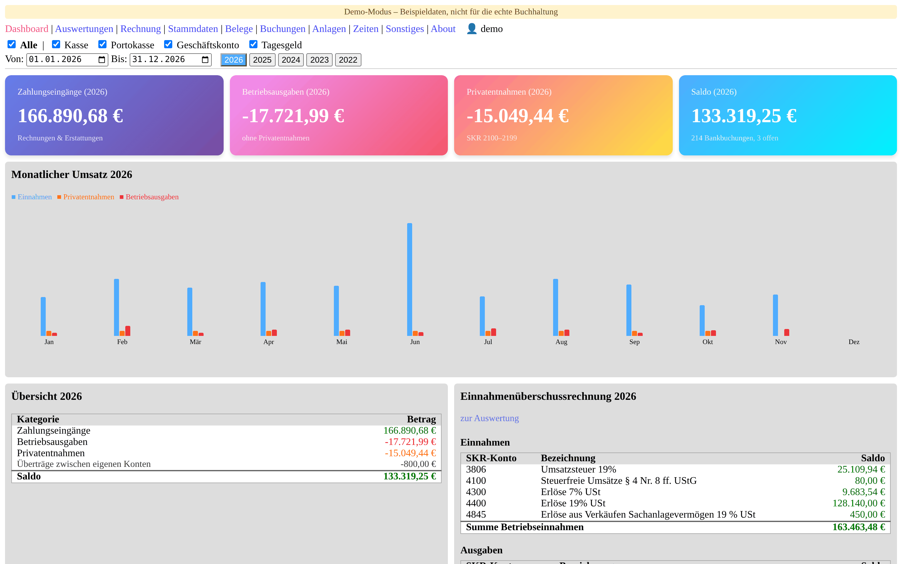
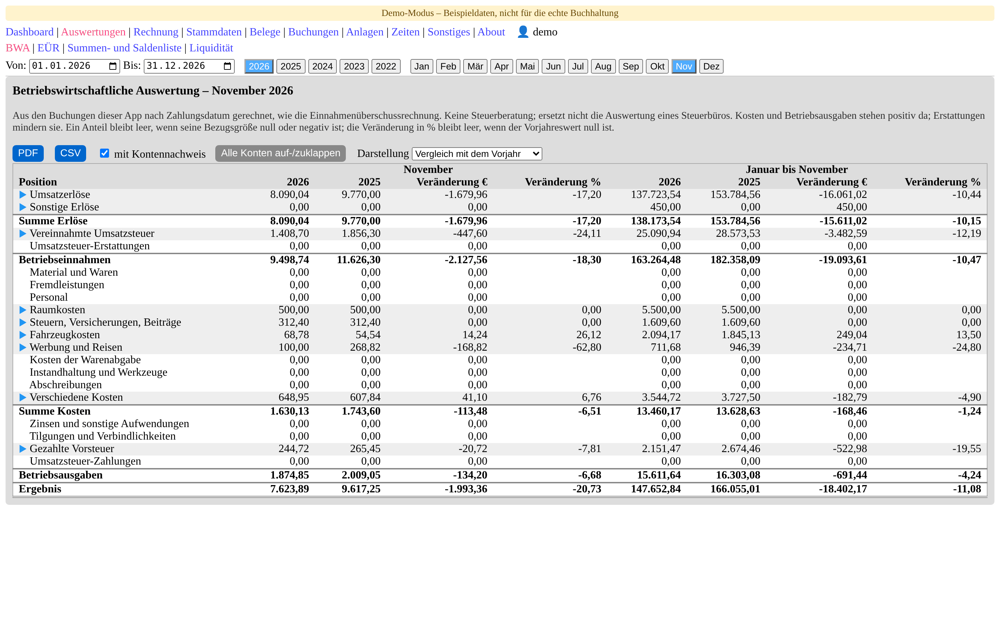
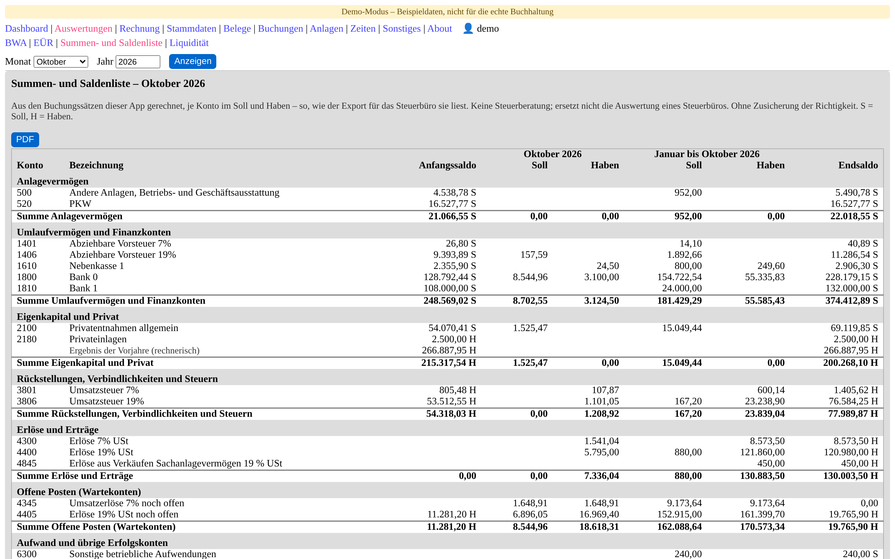
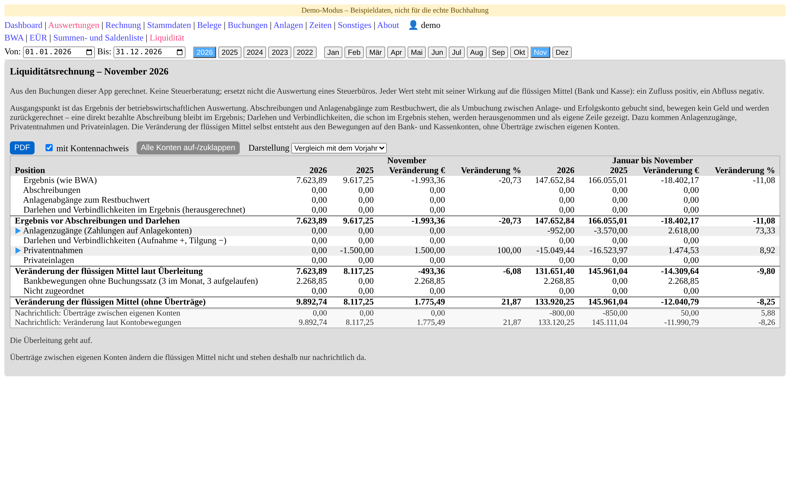
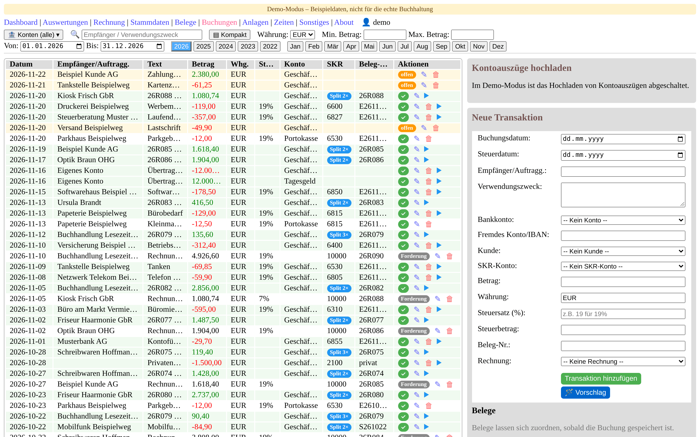
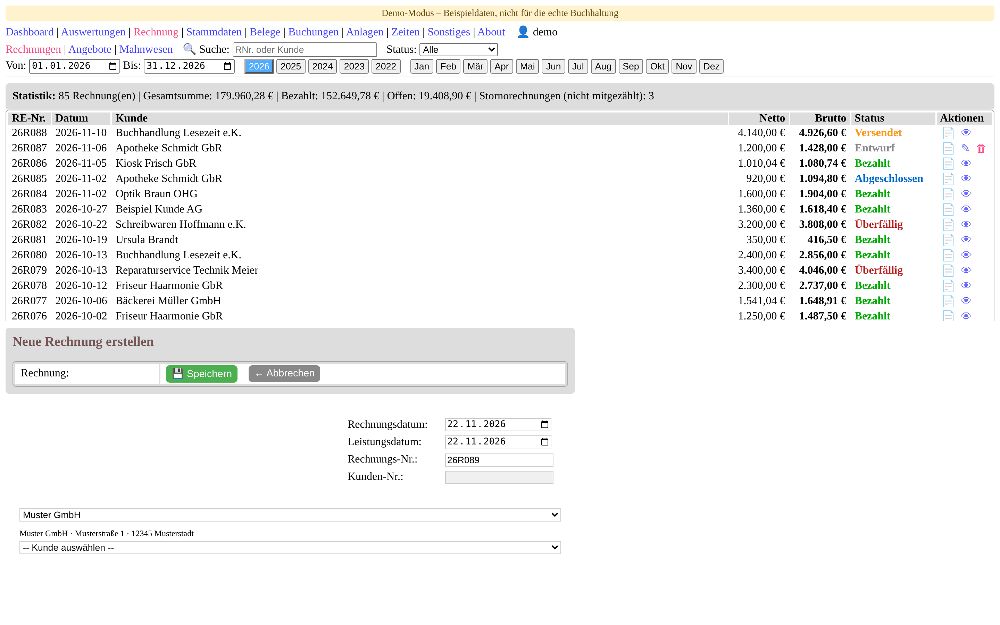
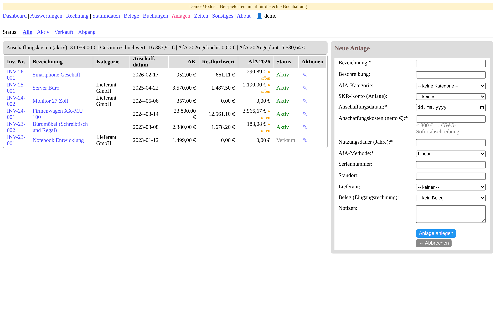
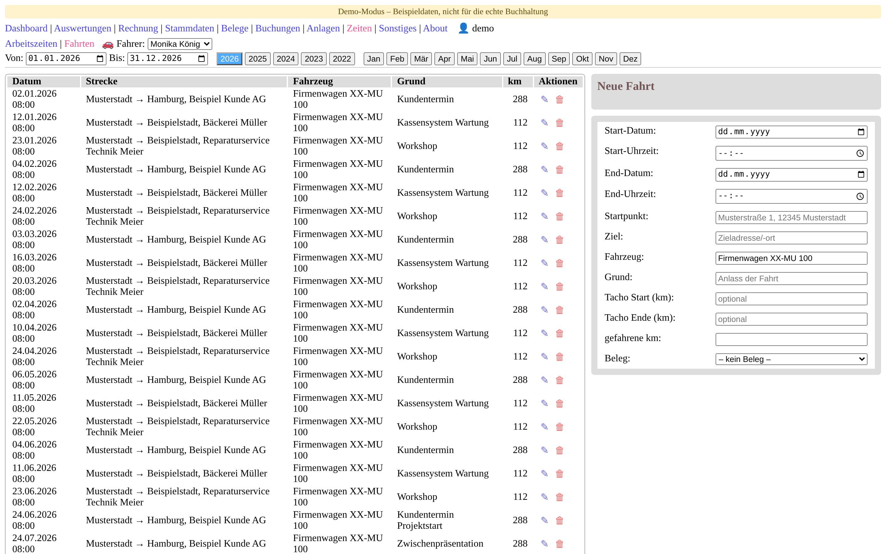
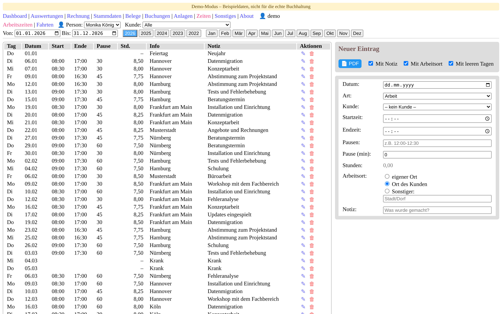

# uBuchhaltung

[](https://github.com/NobseVomBerg/uBuchhaltung/actions/workflows/tests.yml)
[](https://www.gnu.org/licenses/agpl-3.0)

**Selbst gehostete Buchhaltung für Selbstständige und kleine Unternehmen in
Deutschland** – Belege, Bankbuchungen, Einnahmen-Überschuss-Rechnung,
Rechnungen mit XRechnung, Anlagen mit AfA und DATEV-Export. Läuft im eigenen
Netz (Docker, Unraid, Proxmox oder direkt mit Python); die Daten bleiben bei dir.

> **Status:** In aktiver Weiterentwicklung; neue Versionen erscheinen als
> Docker-Image und GitHub-Release. Oberfläche und Dokumentation sind deutschsprachig.

*In English:* uBuchhaltung is a self-hosted bookkeeping web app for freelancers
and small businesses in Germany – SKR charts of accounts, EÜR (cash-basis
profit statement), XRechnung e-invoices and DATEV export. The user interface and
documentation are in German.

<picture>
  <source media="(prefers-color-scheme: dark)" srcset="docs/screenshots/dashboard-dark.png">
  
</picture>

<details>
<summary><b>Weitere Screenshots</b> (Auswertungen, Buchungen, Rechnungen, Anlagen, Fahrtenbuch, Arbeitszeiten)</summary>

**Betriebswirtschaftliche Auswertung** – ein Monat und das laufende Jahr im Vergleich mit dem Vorjahr, auch als PDF und CSV

<picture>
  <source media="(prefers-color-scheme: dark)" srcset="docs/screenshots/bwa-dark.png">
  
</picture>

**Summen- und Saldenliste** – je Konto Anfangssaldo, Soll, Haben und Endsaldo, auch als PDF und CSV

<picture>
  <source media="(prefers-color-scheme: dark)" srcset="docs/screenshots/susa-dark.png">
  
</picture>

**Liquiditätsrechnung** – vom Ergebnis zur Veränderung der flüssigen Mittel, auch als PDF

<picture>
  <source media="(prefers-color-scheme: dark)" srcset="docs/screenshots/liquiditaet-dark.png">
  
</picture>

**Buchungen** – Bankbewegungen mit Kontierung, Split-Buchungen und Rechnungszahlungen

<picture>
  <source media="(prefers-color-scheme: dark)" srcset="docs/screenshots/transactions-dark.png">
  
</picture>

**Rechnungen** – Status von Entwurf bis bezahlt, offene Posten und Teilzahlungen

<picture>
  <source media="(prefers-color-scheme: dark)" srcset="docs/screenshots/invoice-list-dark.png">
  
</picture>

**Anlagenverzeichnis** – Restbuchwerte und geplante AfA

<picture>
  <source media="(prefers-color-scheme: dark)" srcset="docs/screenshots/assets-dark.png">
  
</picture>

**Fahrtenbuch**

<picture>
  <source media="(prefers-color-scheme: dark)" srcset="docs/screenshots/trips-dark.png">
  
</picture>

**Arbeitszeiten**

<picture>
  <source media="(prefers-color-scheme: dark)" srcset="docs/screenshots/worktime-dark.png">
  
</picture>

Alle Screenshots zeigen erfundene Beispieldaten aus dem [Demo-Modus](#schnellstart).
</details>

## Schnellstart

Erst einmal ausprobieren – mit erfundenen Beispieldaten, ohne Einrichtung
(beim Beenden ist alles wieder weg):

```bash
docker run --rm -p 2824:2824 -e UBUCHHALTUNG_DEMO=1 ghcr.io/nobsevomberg/ubuchhaltung:latest
```

Dann `http://localhost:2824` öffnen: Jeder Besucher arbeitet dort ohne Anmeldung
als Benutzer „demo“ (kein Administrator). Der Demo-Modus ist nur zum lokalen
Ausprobieren gedacht – Details in [DEPLOYMENT.md](DEPLOYMENT.md#demo-modus-ausprobieren).

Für den echten Betrieb:

Mit Docker (Server, NAS, Unraid, Proxmox & Co.) und eigenem Datenverzeichnis:

```bash
docker run -d --name ubuchhaltung --restart unless-stopped \
  -p 2824:2824 -v /pfad/zu/daten:/app/data \
  ghcr.io/nobsevomberg/ubuchhaltung:latest
```

Unter Unraid geht es ohne Kommandozeile: im Tab **Apps** (Community Applications)
nach „uBuchhaltung“ suchen. Danach unter `http://<host>:2824` öffnen; die
Ersteinrichtung läuft im Browser.
Ohne Docker: `pip install -r requirements.txt` und `python main.py`
(Python 3.13 oder neuer, dann unter `http://localhost:8080`). Mehr dazu unter
[Installation und Start](#installation-und-start) und in
[DEPLOYMENT.md](DEPLOYMENT.md).

Kommst du von Version 1.x? Der erste Start von Version 2 zieht eine bestehende
Einzelbenutzer-Installation in die neue Ablage `data/users/admin/` um (weiterhin ohne
Anmeldung). Vorher eine Datensicherung anlegen – Ablauf und Rückweg unter
[Umzug auf Version 2](DEPLOYMENT.md#umzug-auf-version-2).

## Funktionen im Überblick

| Bereich | Was drin ist |
|---|---|
| **Buchen** | Bankbewegungen und Buchungssätze, Split-Buchungen, Kontierungs-Vorschlag aus der Historie, Belege verknüpfen. Zu einem Zahlungseingang schlägt die App die passende offene Rechnung vor – zugeordnet wird erst auf Klick |
| **Belege** | Dateien hochladen, ansehen und mit Buchungen verknüpfen. E-Rechnungen (XRechnung, ZUGFeRD) werden strukturiert gelesen, PDFs mit Textebene über feste Regeln; dazu Vorschläge für die passende Bankbewegung – verknüpft wird erst auf Klick. Keine Texterkennung für Scans und Fotos; gelesene Werte sind zu prüfen |
| **Kontenrahmen** | SKR04 vorbelegt, eigene Konten (auch weiterer Rahmen wie SKR03) anlegbar, DATEV-Steuerschlüssel |
| **Auswertung** | Dashboard mit Monatsverlauf, Einnahmen-Überschuss-Rechnung (EÜR), betriebswirtschaftliche Auswertung, Summen- und Saldenliste und Liquiditätsrechnung – als Seite und PDF, die BWA und die Summen- und Saldenliste auch als CSV |
| **Rechnungen & Angebote** | PDF als hybride E-Rechnung (ZUGFeRD/Factur-X, EN 16931) und XRechnung, Steuersatz je Position, E-Mail-Versand, Nummernkreise, Stornorechnung, offene Posten, Mahnwesen, Kleinunternehmerregelung |
| **Anlagen** | Anlagenverzeichnis mit AfA (linear, degressiv, GWG) |
| **Import & Export** | Kontoauszüge als CAMT.053 (XML oder ZIP, jede Bank), PDF (DKB, Volksbank Rottweil) oder CSV (Umsatzliste der DKB), [Datenübernahme aus WISO Mein Büro](#datenübernahme-aus-wiso-mein-büro), DATEV-Buchungsstapel |
| **Außerdem** | Arbeitszeiten mit Stundenzettel, Fahrtenbuch, ein Benutzer ohne Anmeldung oder mehrere mit Login, Datensicherung, Dark Mode |

Alle Funktionen ausführlich: [Funktionen im Detail](#funktionen-im-detail).

## Gut zu wissen

- **Keine Steuerberatung.** uBuchhaltung hilft beim Buchen und Auswerten; die
  Verantwortung für eine ordnungsgemäße Buchführung und für Steuererklärungen
  bleibt beim Anwender. Eine Prüfung oder Zusicherung der GoBD-Konformität gibt
  es nicht.
- **Noch nicht enthalten:** Umsatzsteuer-Voranmeldung bzw. ELSTER-Übermittlung,
  Soll-Versteuerung (die App führt Erlös und Umsatzsteuer nach dem Zahlungseingang; die
  Besteuerungsart lässt sich an der eigenen Firma festhalten, ändert aber keine Buchung),
  Bankanbindung per FinTS/PSD2 und Kontoauszüge im MT940-Format.
- **Für den Betrieb im eigenen Netz gebaut**, nicht fürs offene Internet –
  siehe [Sicherheitshinweise](#sicherheitshinweise).
- **Updates mit Schemaänderung:** Vor jeder Umstellung einer bestehenden Datenbank legt die App
  beim Start automatisch eine Sicherung an: `<Datenordner>/backup/JJJJMMTT_vor_<Version>_buch.db`
  (eine vorhandene Datei wird nie überschrieben). Gelingt die Sicherung nicht, öffnet die Datenbank
  nicht und bleibt unverändert; bricht die Umstellung ab, ist die Datenbank danach so wie vorher.
  Eine Datenbank einer neueren Version öffnet die App nie – ein Zurück auf eine ältere Version gibt
  es nur über die Sicherung. Die Sicherungen lassen sich auf der Seite *Daten* (Abschnitt
  Datensicherung) herunterladen.
  **Sicherung zurückspielen** (die Oberfläche bietet das für diese Kopien nicht an): uBuchhaltung
  beenden, die Datei `backup/<Datum>_vor_<Version>_buch.db` im Datenordner des Nutzers
  (`data/users/<Name>/`, im Container das eingebundene Datenverzeichnis) über `buch.db` kopieren –
  liegen daneben `buch.db-journal`, `buch.db-wal` oder `buch.db-shm`, diese vorher löschen – und die
  ältere Programmversion starten. Was nach der Umstellung eingegeben wurde, geht dabei verloren.

Fehler gefunden oder eine Idee? → [Issues](https://github.com/NobseVomBerg/uBuchhaltung/issues).
Beiträge sind willkommen, siehe [CONTRIBUTING.md](CONTRIBUTING.md).

---

## Datenübernahme aus WISO Mein Büro

uBuchhaltung kann vorhandene Daten aus WISO Mein Büro (Desktop) übernehmen –
direkt aus der Datenbankdatei oder aus den Textexporten (*Daten* → *Import aus der Datenbank* bzw. WISO-Import):

- **Import aus der Datenbank:** liest die Firebird-Dateien (`.FDB`) des Mandanten direkt in Python – ohne
  Firebird-Installation. `DB1.FDB` (Mandant) und optional `DB0.FDB` (Standard-Kontenrahmen) aus dem
  DB-Verzeichnis von WISO werden im Browser hochgeladen (bis 2 GB je Datei, auch bei Betrieb im Container);
  nach dem Import löscht der Server sie wieder. Übernommen werden Buchungen aller Jahre mit ihren Teilbuchungen,
  Anlagen samt AfA-Plan, Kunden sowie Rechnungen mit Positionen. Am sichersten ist eine Kopie der Datei bei
  geschlossenem WISO; ein nicht sauber beendeter Stand wird nicht halbfertig übernommen, der Import nennt, wie viele Sätze das betraf.
- **Textexport:** der Original- und der Tabellen-Export, auch wiederholt im Parallelbetrieb – Details in
  [PARSER_README.md](PARSER_README.md). CSV- und Datenbank-Import lassen sich nacheinander nutzen; bereits
  übernommene Buchungen werden erkannt und nicht verdoppelt.
- **Konten:** SKR03 wird nach SKR04 umgeschlüsselt. Konten ohne eindeutige Zuordnung werden gemeldet, nicht geraten.
- **BU-Schlüssel** der Buchungen und die Berater-/Mandantennummer (bei leeren Feldern der eigenen Firma) werden übernommen und gehen in den DATEV-Stapel.
- **Ein Import in einen leeren Bestand** ist der vorgesehene Weg; ein weiterer Import verlangt eine ausdrückliche
  Bestätigung. Buchungen, die es in WISO nicht mehr gibt, bleiben im Bestand stehen und stehen in einer Liste auf *Daten* –
  gelöscht wird nichts.
- **Meldungen statt Raten:** Was der Import nicht sicher lesen oder zuordnen kann (Sätze mit negativem Bruttobetrag, unbekannte Steuerschlüssel,
  Buchungen auf Konten 1000–1099, mögliche Doppelungen, abweichende Anlagenpläne), meldet er nach dem Lauf – lieber eine sichtbare zweite Buchung als eine still falsche.

Empfehlung: den Datenbank-Import mit einer Kopie der Datenbankdatei durchführen. Die genauen Regeln stehen in
[`docs/regeln/import.md`](docs/regeln/import.md).

> WISO, MeinBüro, DATEV und die genannten Banken sind Marken ihrer jeweiligen Inhaber. uBuchhaltung ist ein
> unabhängiges Projekt und steht in keiner Verbindung zu den Markeninhabern oder
> dem Hersteller. Die Namen dienen allein der Bezeichnung der unterstützten
> Importformate.

---

## Funktionen im Detail

Jede Funktion mit ihrer Seite im Browser. Die Regeln hinter den Funktionen stehen in [`docs/regeln/`](docs/regeln/).

### Belege (`/receipts`)
- Dateien hochladen (auch mehrere): Jede Datei wird sofort ein Beleg mit Nummer aus dem Kreis *Belegnummern Firma*, liegt unter
  `Belege/<Jahr>/` und lässt sich ansehen (PDF, Bilder) und herunterladen. Ein Kontoauszug ist dort ein Beleg wie jede andere Datei –
  importiert wird er auf der Seite *Buchungen*.
- Bearbeiten und Löschen; gelöscht wird ein Beleg nur, solange keine Buchung, Anlage oder Fahrt auf ihn verweist.
- Belege und Buchungen verknüpfen: am Beleg eine Buchung suchen, in der Buchungsmaske einen Beleg.
- Belege lesen: E-Rechnungen (XRechnung, ZUGFeRD/Factur-X) aus ihren Feldern, PDFs mit Textebene über feste Regeln – Belegdatum,
  Rechnungsnummer, Absender, USt-IdNr., Brutto, Netto, Steuer, Steuersatz, Währung. Jeder Wert nennt seine Herkunft; ist er nicht eindeutig,
  bleibt das Feld leer. Dazu Vorschläge für passende Bankbewegungen – **verknüpft oder gebucht wird nichts ohne Klick**.
  Grenzen: keine Texterkennung für Scans und Fotos, nicht jede Rechnung ist lesbar, ein gelesener Wert ist eine Lesung, kein geprüfter Inhalt.
  Im Demo-Modus ist das Lesen abgeschaltet.
- Regeln: [`docs/regeln/belege.md`](docs/regeln/belege.md)

### Buchungen (`/transactions`)
- Bankbewegungen (Import oder Erfassung) und Buchungssätze in einer Liste; Split-Buchungen (mehrere Buchungssätze je Bankbewegung),
  Status „verknüpft/offen“, Filter nach Datum, Konto, Kunde, Währung und Betrag.
- **Kontoauszug-Import:** CAMT.053 (XML/ZIP, alle Banken), PDF (DKB, Volksbank Rottweil) oder CSV (Umsatzliste der DKB), mit Vorschau,
  Duplikat-Erkennung und Saldo-Prüfung; erst danach wird übernommen. Bei einem **gemischt genutzten Konto** (Haken „Reines Geschäftskonto“
  in den Stammdaten entfernen) lassen sich einzelne Umsätze auswählen. Grenzen und Einzelheiten:
  [PARSER_README.md](PARSER_README.md), [`docs/regeln/import.md`](docs/regeln/import.md)
- **Vorschlag** (🪄): kontiert eine offene Buchung aus der Historie desselben Empfängers (Konto, Steuersatz, nächste Beleg-Nr.); gespeichert
  wird erst beim Speichern.
- Belege in der Maske suchen, zuordnen, ansehen und lösen.
- Regeln: [`docs/regeln/buchungen.md`](docs/regeln/buchungen.md)

### Stammdaten (`/masterdata`)
- **Bankkonten** (`/masterdata/bankaccounts`): Name, IBAN, BIC, zugeordnetes SKR-Konto, Kennzeichen „Reines Geschäftskonto“ (Standard).
  Die Kasse legt die App selbst an (SKR04 1600, nicht löschbar).
- **Kontenrahmen** (`/masterdata/skr`): Standardkonten SKR04 aus `seed_data/`; eigene Konten und weitere Rahmen (SKR03, SKR07, Branchen) anlegbar.
  Fehlende Standardkonten einer neueren Version ergänzt die Seite auf Knopfdruck, nie von selbst.
- **Kontakte** (`/masterdata/contacts`): Unternehmen und Personen als Kunde, Lieferant, eigene Firma u. a., mit Adressen und Logo
  (PNG, JPG, GIF, WEBP bis 5 MB).
- **Artikel** (`/masterdata/articles`): Bezeichnung, Einheit, Nettopreis, Steuersatz; für Rechnungen und Angebote.
- **Nummernkreise** (`/masterdata/numberranges`): Rechnungen, Angebote, Belegnummern Firma und Kategorien, Format z. B. `26R001`.
- **AfA-Kategorien** (`/asset_categories`) und **Steuersätze/Befreiungsgründe** für Rechnungen.
- Gelöscht werden kann nur, worauf nichts mehr verweist; die Seite nennt, was daran hängt.

### Rechnungen (`/invoice`)
- PDF-Rechnung mit Logo; jede neu erzeugte Rechnungs-PDF ist PDF/A-3b mit eingebetteter `factur-x.xml` (ZUGFeRD/Factur-X, Profil EN 16931).
  Die **XRechnung** (UBL) entsteht bei einer Rechnung mit Leitweg-ID, wenn die Pflichtangaben vollständig sind – sonst nennt die Seite, was fehlt.
  Eine Zusicherung der Konformität gibt es nicht.
- Steuersatz je Position, weitere Sätze und steuerfreie Leistungen aus den Stammdaten; bei Kleinunternehmern steht der Hinweis auf § 19 UStG im Dokument.
- E-Mail-Versand per SMTP (nur verschlüsselt, mit Zertifikatsprüfung), Empfänger aus den Kontakten; Einrichtung: [DEPLOYMENT.md](DEPLOYMENT.md).
- Status: Entwurf → Abgeschlossen → Versendet → Bezahlt (dazu Teilzahlung, Überfällig, Storniert). Storno über „Stornieren“: Die **Stornorechnung**
  ist ein eigener Beleg mit eigener Nummer; „Stornieren und neu ausstellen“ legt den Entwurf einer neuen Rechnung an.
- **Zahlungen** (Bankbewegung ganz, teilweise oder auf mehrere Rechnungen zuordnen; Überschuss bleibt als Guthaben), **Skonto** (Prozent und Frist im PDF,
  Abzug wird beim Zuordnen auf Klick ausgebucht), **Erstattung** auf der Seite der Stornorechnung. Mit dem Status *Versendet* steht die Rechnung als
  offener Posten in den Büchern; die EÜR bleibt eine Ist-Rechnung (Einnahme erst mit der Zahlung). Eine Prüfliste unter *Daten* zeigt Unstimmigkeiten.
- **Mahnwesen** (`/invoice/reminders`): überfällige Rechnungen mit drei Mahnstufen nach Verzugstagen (bis 30, bis 60, über 60 Tage) und eine Vorschau der in 7 Tagen fälligen.
- **Angebote** (`/quote`): gleiche Positionen und PDF-Logik, eigener Nummernkreis, Gültigkeitsdatum, Umwandlung in eine Rechnung.
- Regeln: [`docs/regeln/rechnungen.md`](docs/regeln/rechnungen.md), [`docs/regeln/zahlungen.md`](docs/regeln/zahlungen.md); Datenmodell: [DB_MODEL.md](DB_MODEL.md)

### Dashboard und Auswertungen (`/`, `/bwa`, `/euer`, `/susa`, `/liquiditaet`)
- **Dashboard** (`/`): Monatsverlauf für Einnahmen, Betriebsausgaben und Privatentnahmen, Jahresübersicht mit Saldo (nach Konto filterbar) und
  EÜR-Kasten (Betriebseinnahmen, Betriebsausgaben, „Sonstige Ausgaben“ separat). Überträge zwischen eigenen Konten zählen weder als Einnahme noch als Ausgabe.
- Unter *Auswertungen* vier Seiten, jede auch als PDF; der Zeitraum kommt aus der Zeitraum-Menüzeile:
  - **Betriebswirtschaftliche Auswertung** (`/bwa`): Monat und aufgelaufenes Jahr, im Vergleich mit dem Vorjahr oder mit Anteilen; Konten aufklappbar; auch als CSV.
  - **Einnahmenüberschussrechnung** (`/euer`): frei gewählter Zeitraum, dieselben Zahlen wie das Dashboard ohne Kontofilter. Kein amtliches Formular.
  - **Summen- und Saldenliste** (`/susa`): je Konto Anfangssaldo, Soll, Haben und Endsaldo, nach Kontenklassen; auch als CSV. Eine Eröffnungsbilanz
    und einen Jahresabschluss gibt es nicht. Kein amtliches Formular.
  - **Liquiditätsrechnung** (`/liquiditaet`): vom Ergebnis der BWA zur Veränderung der flüssigen Mittel, daneben die Bewegungen von Bank und Kasse.
- Abschreibungen erscheinen in der EÜR, nicht in den Zahlungskarten des Dashboards. Keine Steuerberatung, kein Ersatz für die Auswertung eines Steuerbüros.
- Regeln: [`docs/regeln/auswertungen.md`](docs/regeln/auswertungen.md)

### Anlagenverzeichnis (`/assets`)
- AfA-Methoden: linear (anteilig), degressiv (25 %), GWG (bis 800 €); 30 BMF-Kategorien aus `seed_data/`; Inventarnummern `INV-YY-###`; Live-Vorschau des Plans.
- Die AfA wird je Anlage und Jahr als Umbuchung „Aufwand an Anlagekonto“ gebucht; gebuchte Jahre bleiben, wie sie gebucht sind, offene Jahre verteilen
  den Restbuchwert neu. Erweiterungen (nachträgliche Anschaffungskosten) werden mit der Hauptanlage abgeschrieben. Ob das steuerlich passt, klärt das Steuerbüro.
  Ein GWG, das schon beim Kauf auf das Aufwandskonto gebucht wurde, darf nicht zusätzlich abgeschrieben werden – das Programm prüft das nicht.
- Regeln: [`docs/regeln/buchungen.md`](docs/regeln/buchungen.md)

### Daten (`/miscellaneous`)
- **Import:** WISO-Datenübernahme (siehe oben).
- **DATEV-Export:** Buchungsstapel als DATEV-CSV je Kalenderjahr. Der Stapel bildet nach, was WISO Mein Büro schreibt; ob das Steuerbüro ihn annimmt, klärt es selbst.
  Berater- und Mandantennummer stehen im Kontaktformular der eigenen Firma. Bankbewegungen ohne Buchungssatz und unstimmige Splits meldet der Export,
  bevor er schreibt. Regeln: [`docs/regeln/auswertungen.md`](docs/regeln/auswertungen.md)
- **Datensicherung und Wiederherstellung:** Archiv nach `<Datenordner>/backup/` (7-Zip, sonst `.zip`; nur Datenbank oder alle Daten); vorhandene Sicherungen
  lassen sich herunterladen und löschen (nicht im Demo-Modus). Regeln: [`docs/regeln/sicherung.md`](docs/regeln/sicherung.md)

### Arbeitszeiten (`/worktime`)
- Zeiterfassung je Person (Arbeit, Urlaub, Krank, Feiertag) mit Pausen, Einsatzort und Kundenzuordnung; Überlappungsprüfung; Schichten über Mitternacht.
- PDF-Stundenzettel, je Kunde filterbar. Regeln: [`docs/regeln/zeiten-fahrten.md`](docs/regeln/zeiten-fahrten.md)

### Fahrtenbuch (`/trips`)
- Fahrten je Fahrer mit Start, Ziel, km-Ständen und Belegverknüpfung; locker nutzbar (einzelne Fahrten, ohne Tachostand, in beliebiger Reihenfolge).
- Lückenprüfung auf Wunsch je Fahrzeug und Jahr – ein Hilfsmittel, keine Steuerberatung.

### Benutzer (`/users`)
- Jeder Benutzer hat ein eigenes Datenverzeichnis `data/users/<Name>/`. Die Ersteinrichtung legt den ersten Administrator an, **ohne Anmeldung**
  (für eine Person im eigenen Netz) oder **mit Passwort** (weitere Benutzer in der Benutzerverwaltung).
- Administratoren legen Benutzer an, löschen sie und setzen Passwörter zurück. Betrieb im LAN und mit HTTPS: [DEPLOYMENT.md](DEPLOYMENT.md).

### About (`/about`)
- Version, „Projekt in Zahlen“ und Datenbank-Übersicht. Ganz unten, nur für Administratoren: **SQL-Konsole** (auf die eigene Datenbank beschränkt, ohne den
  Haken „Schreiben erlauben“ nur lesend; Hilfen wie „Zeitbereich löschen“) und **DB-Export** (`db-export.sql` im Datenordner des Benutzers).

---

## Installation und Start

Docker (Server, NAS, Unraid, Proxmox) und die Einrichtung für Netz und HTTPS stehen im [Schnellstart](#schnellstart) und in
[DEPLOYMENT.md](DEPLOYMENT.md) (Umgebungsvariablen, Reverse-Proxy, Unraid-Template, Compose, Dauerbetrieb).

**Ohne Docker:** Python 3.13 oder neuer; der Kern läuft mit der Standardbibliothek, dazu `fonttools` (PDF-Erzeugung) und `pdfplumber`
(Lesen von PDF-Kontoauszügen):

```bash
pip install -r requirements.txt
python main.py
```

Erreichbar unter `http://localhost:8080`; die Datenbank wird beim ersten Start mit den Seed-Daten (SKR04, AfA-Kategorien, DATEV-Steuerschlüssel)
angelegt. Port und Adresse ändern `UBUCHHALTUNG_PORT` und `UBUCHHALTUNG_HOST`. Im Container ist der Standardport 2824.

**E-Mail-Versand (optional):** `SMTP_HOST`, `SMTP_PORT`, `SMTP_USER`, `SMTP_PASSWORD` als Umgebungsvariablen – Einzelheiten in
[DEPLOYMENT.md](DEPLOYMENT.md).

### Ersteinrichtung und Alltag
1. Starten, im Browser den Administrator anlegen (ohne Anmeldung oder mit Passwort).
2. Bankkonten (`/masterdata/bankaccounts`, mit SKR-Zuordnung) und Kontakte (`/masterdata/contacts`) anlegen; optional Daten aus WISO Mein Büro übernehmen.
3. Kontoauszüge unter `/transactions` hochladen, Vorschau prüfen, bestätigen; Buchungen kontieren (🪄 Vorschlag aus der Historie).
4. Rechnungen erstellen, PDF und E-Rechnung erzeugen, versenden; Zahlungen zuordnen.
5. Regelmäßig sichern: *Daten* → Datensicherung.

Standard-Daten liegen in `seed_data/*.json` (wirken nur bei leerer Tabelle); eigene Konten-Ergänzungen in `seed_data/private/` (nicht im Repo).

---

## Für Entwickler

Python-Standardbibliothek (`http.server`, kein Framework), SQLite, serverseitig erzeugtes HTML mit etwas JavaScript, Stylesheet `buch.css`.

| Ort | Inhalt |
|---|---|
| `main.py`, `server/` | Einstieg, Routen (`app.py`), POST-Handler (`handlers.py`), Seiten (`pages_*.py`) |
| `db/` | Datenbank-Package aus Domänen-Mixins, Schema in `db/schema.py` |
| `export/` | PDF, E-Rechnung (XRechnung, ZUGFeRD), DATEV, CSV |
| `importers/`, `receipt_reading/` | Kontoauszug- und WISO-Import; Belegerkennung |
| `seed_data/`, `tests/`, `tools/`, `docs/` | Initialdaten, pytest-Suite, Hilfswerkzeuge, Screenshots und offene Aufgaben |
| `data/` | Laufzeitdaten (nicht im Repo): `auth.db`, `config.json`, `users/<Name>/` |

Weiterlesen:
- [`CLAUDE.md`](CLAUDE.md) und [`AGENTS.md`](AGENTS.md): Grundregeln und Hinweise zur Codebasis
- [`docs/regeln/`](docs/regeln/): die Regeln je Bereich (Sicherheit, Buchungen, Rechnungen, Import, Auswertungen, CI, Versionierung)
- [DB_MODEL.md](DB_MODEL.md): Datenbankmodell und Datenfluss
- [PARSER_README.md](PARSER_README.md): Parser und CSV-Import
- [DEPLOYMENT.md](DEPLOYMENT.md): Betrieb, HTTPS, Docker, Demo-Modus, Diagnose-Schnittstelle

Tests:

```bash
pip install -r requirements-dev.txt
python -m pytest -q          # ein Prozess
python -m pytest -q -n 4     # parallel (pytest-xdist)
```

Die Suite läuft bei jedem Push (GitHub Actions); Testdaten sind ausschließlich erfunden.

---

## Sicherheitshinweise

- **Mit Anmeldung**: Login mit scrypt-Passwort-Hashes, Sessions (HttpOnly, SameSite=Strict), CSRF-Schutz für schreibende Anfragen, je Nutzer
  isolierte Daten; optional HTTPS (siehe [DEPLOYMENT.md](DEPLOYMENT.md)).
- **Ohne Anmeldung** (automatische Anmeldung für einen Benutzer) gibt es keine Passwortabfrage – nur auf `localhost` bzw. im eigenen,
  vertrauenswürdigen Netz betreiben.
- **Wichtig:** Konzipiert für lokalen bzw. LAN-Einsatz – **nicht für das offene Internet** (einfacher HTTP-Server, SQL-Konsole mit direktem
  Schreibzugriff auf die eigene Datenbank für Administratoren). Regeln: [`docs/regeln/sicherheit.md`](docs/regeln/sicherheit.md).

---

## Lizenz

Dieses Projekt steht unter der **GNU Affero General Public License v3.0 oder
später (AGPL-3.0-or-later)**. Den vollständigen Lizenztext findest du in der
Datei [`LICENSE`](LICENSE).

Kurz gesagt: Du darfst die Software frei nutzen, weitergeben und verändern.
Wenn du sie veränderst und anderen über ein Netzwerk als Dienst bereitstellst
(z. B. als gehostete Anwendung), musst du den vollständigen Quellcode deiner
Version ebenfalls unter der AGPL verfügbar machen.

Beiträge (Pull Requests) brauchen die Zustimmung zum Contributor License
Agreement, je Pull Request per Kommentar – siehe
[`CONTRIBUTING.md`](CONTRIBUTING.md) und [`CLA.md`](CLA.md).

### Kommerzielle Lizenz

Wer die Software in ein proprietäres Produkt integrieren oder als gehosteten
Dienst anbieten möchte, ohne den eigenen Quellcode unter der AGPL offenlegen
zu müssen, kann eine separate **kommerzielle Lizenz** erwerben.

Anfragen bitte an: **office@unsix.com**

### Unterstützung

Wenn dir das Projekt nützt, freue ich mich über einen Kaffee:
[GitHub Sponsors](https://github.com/sponsors/NobseVomBerg) ☕

## Autor

© 2026 [unsix IT Engineering](https://unsix.de) – entwickelt von NobseVomBerg
