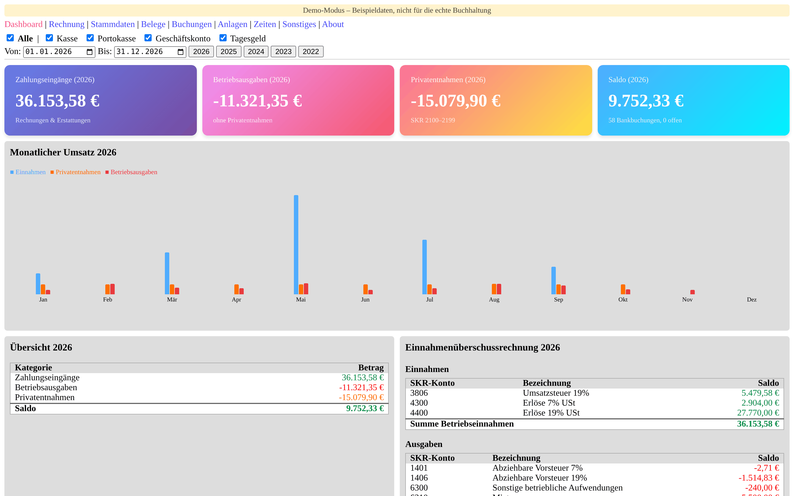
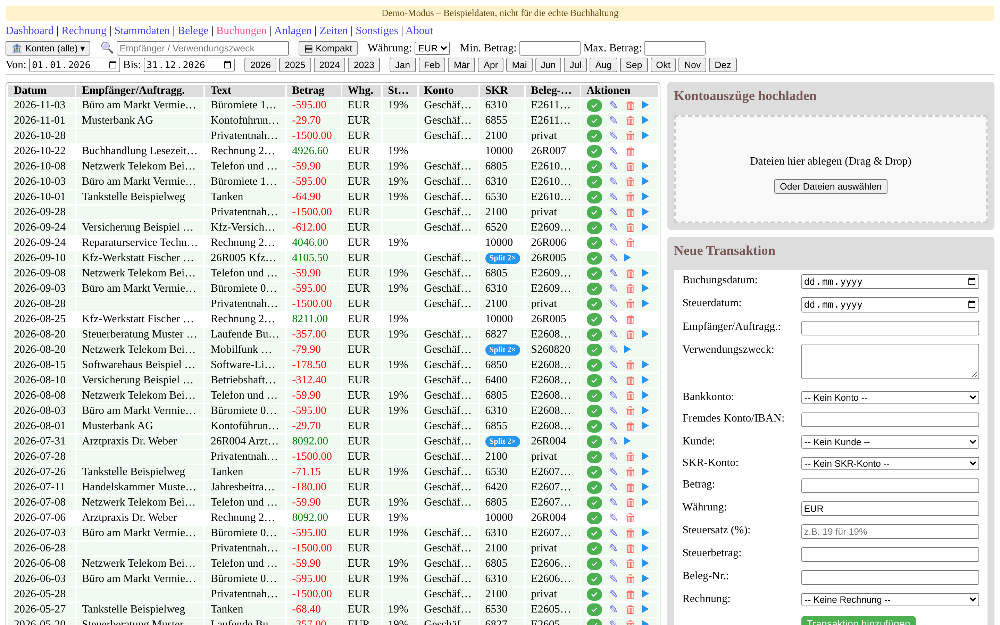
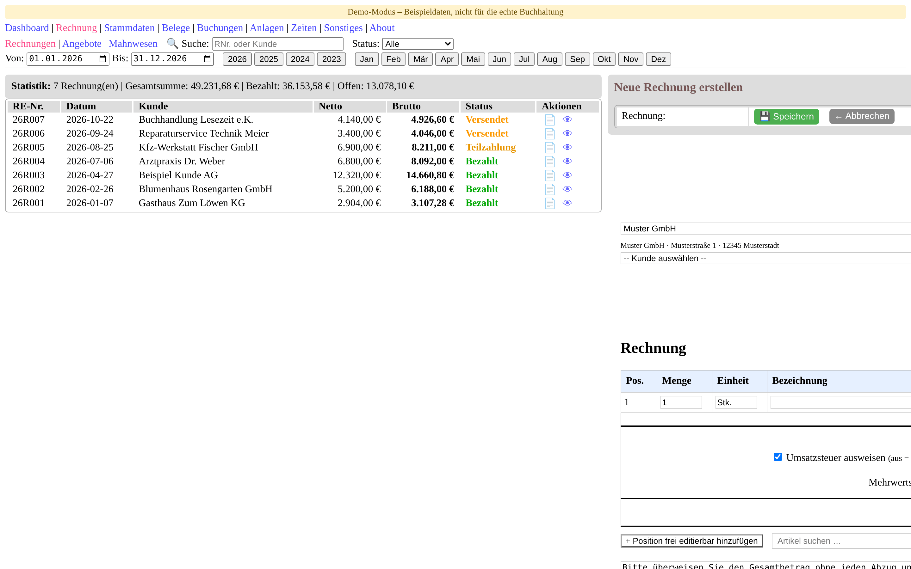
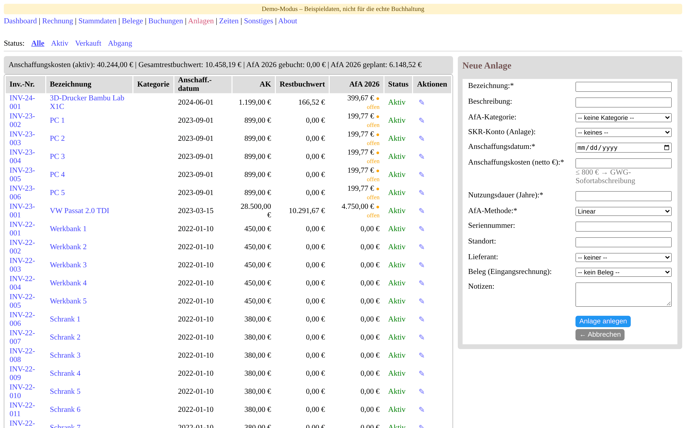
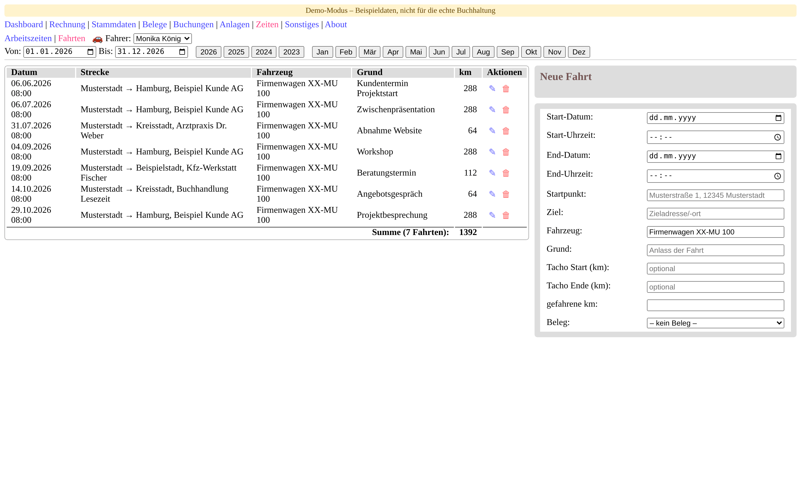
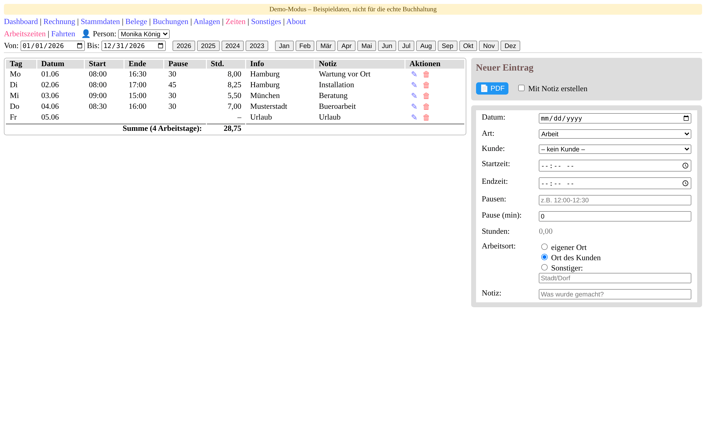

# uBuchhaltung

[](https://github.com/NobseVomBerg/uBuchhaltung/actions/workflows/tests.yml)
[](https://www.gnu.org/licenses/agpl-3.0)

**Selbst gehostete Buchhaltung für Selbstständige und kleine Unternehmen in
Deutschland** – Belege, Bankbuchungen, Einnahmen-Überschuss-Rechnung,
Rechnungen mit XRechnung, Anlagen mit AfA und DATEV-Export. Läuft im eigenen
Netz (Docker, Unraid, Proxmox oder direkt mit Python); die Daten bleiben bei dir.

> **Status:** Im eigenen Betrieb des Entwicklers im Einsatz und in aktiver
> Weiterentwicklung. Oberfläche und Dokumentation sind deutschsprachig.

*In English:* uBuchhaltung is a self-hosted bookkeeping web app for freelancers
and small businesses in Germany – SKR charts of accounts, EÜR (cash-basis
profit statement), XRechnung e-invoices and DATEV export. The user interface and
documentation are in German.

<picture>
  <source media="(prefers-color-scheme: dark)" srcset="docs/screenshots/dashboard-dark.png">
  
</picture>

<details>
<summary><b>Weitere Screenshots</b> (Buchungen, Rechnungen, Anlagen, Fahrtenbuch, Arbeitszeiten)</summary>

**Buchungen** – Bankbewegungen mit Kontierung, Split-Buchungen und Rechnungszahlungen

<picture>
  <source media="(prefers-color-scheme: dark)" srcset="docs/screenshots/transactions-dark.png">
  
</picture>

**Rechnungen** – Status von Entwurf bis bezahlt, offene Posten und Teilzahlungen

<picture>
  <source media="(prefers-color-scheme: dark)" srcset="docs/screenshots/invoice-list-dark.png">
  
</picture>

**Anlagenverzeichnis** – Restbuchwerte und geplante AfA

<picture>
  <source media="(prefers-color-scheme: dark)" srcset="docs/screenshots/assets-dark.png">
  
</picture>

**Fahrtenbuch**

<picture>
  <source media="(prefers-color-scheme: dark)" srcset="docs/screenshots/trips-dark.png">
  
</picture>

**Arbeitszeiten**

<picture>
  <source media="(prefers-color-scheme: dark)" srcset="docs/screenshots/worktime-dark.png">
  
</picture>

Alle Screenshots zeigen erfundene Beispieldaten aus dem [Demo-Modus](#schnellstart).
</details>

## Schnellstart

Erst einmal ausprobieren – mit erfundenen Beispieldaten, ohne Einrichtung
(beim Beenden ist alles wieder weg):

```bash
docker run --rm -p 2824:2824 -e UBUCHHALTUNG_DEMO=1 ghcr.io/nobsevomberg/ubuchhaltung:latest
```

Dann `http://localhost:2824` öffnen: Jeder Besucher arbeitet dort ohne Anmeldung
als Benutzer „demo“ (kein Administrator). Der Demo-Modus ist nur zum lokalen
Ausprobieren gedacht – Details in [DEPLOYMENT.md](DEPLOYMENT.md#demo-modus-ausprobieren).

Für den echten Betrieb:

Mit Docker (Server, NAS, Unraid, Proxmox & Co.) und eigenem Datenverzeichnis:

```bash
docker run -d --name ubuchhaltung --restart unless-stopped \
  -p 2824:2824 -v /pfad/zu/daten:/app/data \
  ghcr.io/nobsevomberg/ubuchhaltung:latest
```

Unter Unraid geht es ohne Kommandozeile: im Tab **Apps** (Community Applications)
nach „uBuchhaltung“ suchen. Danach unter `http://<host>:2824` öffnen; die
Ersteinrichtung läuft im Browser.
Ohne Docker: `pip install -r requirements.txt` und `python main.py`
(Python 3.10+, dann unter `http://localhost:8080`). Mehr dazu unter
[Installation und Start](#installation-und-start) und in
[DEPLOYMENT.md](DEPLOYMENT.md).

Kommst du von Version 1.x? Der erste Start von Version 2 zieht eine bestehende
Einzelbenutzer-Installation in die neue Ablage `data/users/admin/` um (weiterhin ohne
Anmeldung). Vorher eine Datensicherung anlegen – Ablauf und Rückweg unter
[Umzug auf Version 2](DEPLOYMENT.md#umzug-auf-version-2).

## Funktionen im Überblick

| Bereich | Was drin ist |
|---|---|
| **Buchen** | Bankbewegungen und Buchungssätze, Split-Buchungen, Kontierungs-Vorschlag aus der Historie, Belege verknüpfen |
| **Kontenrahmen** | SKR04 vorbelegt, eigene Konten (auch weiterer Rahmen wie SKR03) anlegbar, DATEV-Steuerschlüssel |
| **Auswertung** | Dashboard mit Monatsverlauf, Einnahmen-Überschuss-Rechnung (EÜR) |
| **Rechnungen & Angebote** | PDF als hybride E-Rechnung (ZUGFeRD/Factur-X, EN 16931) und XRechnung, E-Mail-Versand, Nummernkreise, offene Posten, Mahnwesen, Kleinunternehmerregelung |
| **Anlagen** | Anlagenverzeichnis mit AfA (linear, degressiv, GWG) |
| **Import & Export** | Kontoauszüge im Bankformat CAMT.053 (XML oder ZIP, jede Bank) oder als PDF (DKB, Volksbank Rottweil), [Datenübernahme aus WISO Mein Büro](#datenübernahme-aus-wiso-mein-büro), DATEV-Buchungsstapel |
| **Außerdem** | Arbeitszeiten mit Stundenzettel, Fahrtenbuch, ein Benutzer ohne Anmeldung oder mehrere mit Login, Datensicherung, Dark Mode |

Alle Funktionen ausführlich: [Funktionen im Detail](#funktionen-im-detail).

## Datenübernahme aus WISO Mein Büro

uBuchhaltung kann vorhandene Daten aus WISO Mein Büro (Desktop) übernehmen –
direkt aus der Datenbankdatei oder aus den Textexporten:

- **Import aus der Datenbank** (*Verschiedenes → Import aus der Datenbank*):
  liest die Firebird-Dateien (`.FDB`) des Mandanten direkt in Python – ohne
  Firebird-Installation, Treiber oder DLL. Übernommen werden Buchungen aller
  Jahre einschließlich der Zusammengehörigkeit von Teilbuchungen, Anlagen,
  Kunden sowie Rechnungen mit ihren Positionen.
- Konten werden von SKR03 nach SKR04 umgeschlüsselt. Konten ohne eindeutige
  Zuordnung werden gemeldet, nicht geraten.
- Vor dem Schreiben prüft der Import die Tabellenstruktur und bricht ab, wenn
  sie nicht der erwarteten entspricht.
- **CSV-Import** der Textexporte (Original- und Tabellen-Export), auch
  wiederholt im Parallelbetrieb – Details in [PARSER_README.md](PARSER_README.md).

Empfehlung: den Datenbank-Import mit einer Kopie der Datenbankdatei durchführen.

> WISO und MeinBüro sind Marken ihrer jeweiligen Inhaber. uBuchhaltung ist ein
> unabhängiges Projekt und steht in keiner Verbindung zu den Markeninhabern oder
> dem Hersteller. Die Namen dienen allein der Bezeichnung der unterstützten
> Importformate.

## Gut zu wissen

- **Keine Steuerberatung.** uBuchhaltung hilft beim Buchen und Auswerten; die
  Verantwortung für eine ordnungsgemäße Buchführung und für Steuererklärungen
  bleibt beim Anwender. Eine Prüfung oder Zusicherung der GoBD-Konformität gibt
  es nicht.
- **Noch nicht enthalten:** Umsatzsteuer-Voranmeldung bzw. ELSTER-Übermittlung,
  Bankanbindung per FinTS/PSD2 sowie Kontoauszüge im MT940-Format.
- **Für den Betrieb im eigenen Netz gebaut**, nicht fürs offene Internet –
  siehe [Sicherheitshinweise](#sicherheitshinweise).

Fehler gefunden oder eine Idee? → [Issues](https://github.com/NobseVomBerg/uBuchhaltung/issues).
Beiträge sind willkommen, siehe [CONTRIBUTING.md](CONTRIBUTING.md).

---

## Funktionen im Detail

uBuchhaltung verwaltet Belege, Konten und Buchungen auf Basis des deutschen
Standardkontenrahmens (SKR). Bankbewegungen (`BookingType='bank'`) und
Buchungssätze (`BookingType='entry'`) werden in einer gemeinsamen Tabelle
geführt und automatisch verknüpft.

### 1. Belege-Verwaltung (`/receipts`)
- Übersicht aller Belege mit Nummer, Datum, Dateiname, Pfad und Zusatzinfos
- Hinzufügen, Bearbeiten, Löschen
- Many-to-Many-Verknüpfung mit Buchungen (BookingDocuments)
- UNIQUE-Constraint in `BookingDocuments` auf `(Booking_ID, Document_ID)` verhindert doppelte Verknüpfungen

### 2. Buchungen (`/transactions`)
Zentrale Verwaltung aller Buchungstransaktionen:
- **Zwei Buchungstypen**:
  - `bank` – echte Bankbewegung (Import aus Kontoauszug oder WISO-Tabellen-Export)
  - `entry` – Buchungssatz (aus WISO-Original-Export oder manuell)
- **Kontoauszug-Import**: CAMT.053 (XML/ZIP, alle Banken) oder PDF (DKB, Volksbank Rottweil) –
  Vorschau mit Duplikat-Erkennung und Saldo-Prüfung, erst dann übernehmen; Details in
  [PARSER_README.md](PARSER_README.md)
- **Automatische Verknüpfung**: Bank↔Entry über `ParentBooking_ID` (via `link_bank_to_entries()`)
- **Merged Display**: Bankbuchungen zeigen verknüpfte Entry-Daten (SKR-Konto, Steuersatz, Belegnr.)
- **Status-Badges**: ✓ verknüpft / offen für Bankbuchungen; ✓ für Einzelbuchungen und Split-Gruppenköpfe mit vollständig gebuchten Kinder-Einträgen
- **Doppik-Filter**: Reine Gegenbuchungen auf Bankkonten (z.B. SKR 1810) werden automatisch ausgeblendet
- **Erweiterte Buchungsfelder**:
  - Buchungsdatum und Steuerdatum (getrennt)
  - SKR-Sollkonto (`COA_ID`) und Gegenkonto (`CounterCOA_ID`)
  - Steuersatz und berechneter Steuerbetrag
  - Multi-Währung (EUR, USD, GBP, CHF)
  - Kontakt-, Kategorie- und Dokumentnummer-Zuordnung
  - Fremde IBAN (`ForeignBankAccount`)
- **Split-Buchungen**: mehrere Buchungssätze je Bankbewegung (`ParentBooking_ID`), im Buchungssatz-Editor der Bankbewegung gepflegt
- **Vorschlag** (🪄): kontiert eine offene Buchung aus der Historie desselben
  Empfängers – SKR-Konto und Steuersatz der letzten passenden Buchung, dazu die
  nächste Beleg-Nr. aus dem Nummernkreis *Belegnummern Firma*. War die Vorlage
  ein Split, wird nach Rückfrage die ganze Aufteilung übernommen (inklusive
  Umbuchungen wie Privatanteilen); die Beträge passt man danach an. Gespeichert
  wird nichts – der Nutzer bleibt im Formular, und die Beleg-Nr. wird erst beim
  Speichern verbraucht
- **Erweiterte Filter**: Datum, Konto, Kunde, Währung, Betragsbereich – alle kombinierbar

### 3. Konten-Verwaltung (`/masterdata/bankaccounts`)
- Übersicht aller Bank-/Kassenkonten (Name, Inhaber, IBAN, BIC, BankName)
- SKR-Kontozuordnung (`SKRAccount`) für automatische Doppik-Erkennung
- Kasse als Sonderform (automatisch beim Start angelegt, nicht löschbar)
- CRUD-Funktionalität

### 4. Standardkontenrahmen (SKR) (`/masterdata/skr`)
- Kontenrahmen-Auswahlliste beim Anlegen: SKR 03/04 (Deutschland), SKR 07 (Österreich),
  SKR 14/49/51/70 (Branchen) – Server validiert Rahmen und Kontonummer
- **Standard-Umschalter**: eigene Konten als Standard anlegbar; Standard-Konten werden
  nach Entfernen des Hakens editier- und löschbar (Referenz-Schutz bleibt)
- **Automatisches Seeding**: Standard-SKR04-Konten beim DB-Erstellen aus `seed_data/`
- CRUD-Funktionalität, UNIQUE(Framework, AccountNumber), Menü-Sichtbarkeit je Konto

### 5. Kontakte (`/masterdata/contacts`)
Normalisiertes 3NF-Schema (6 Tabellen):
- **Entitätstypen**: Unternehmen und Personen mit separaten Formularen
- **Kontakttypen**: Kunde, Lieferant, Eigene Daten, Versicherung, Sonstiges –
  Mehrfachzuordnung über ContactTypeLinks, Personen-Rollen über PersonRoles
- **Logo-Verwaltung**: File-Picker mit Live-Vorschau
- **Tabellen**: Contacts (Basis) + ContactAddresses (1:n) + CompanyDetails (1:1)
  + PersonDetails (1:1) + ContactTypeLinks (n:m) + PersonRoles (n:m)

### 6. Rechnungserstellung (`/invoice`)
Professionelle Rechnungserstellung mit PDF, E-Mail-Versand und XRechnung:
- **Multi-Company-Support**: Eigene Firma wählbar, dynamisches Logo
- **Snapshot-Prinzip**: Verkäufer- und Käuferdaten werden bei Erstellung als Kopie gespeichert
- **Positionstabelle**: Beliebig viele Positionen, Artikelverzeichnis-Integration
- **PDF-Generierung** (`export/pdf_invoice.py` auf Basis von `export/pdf_core.py`): A4-Layout, Logo, Umlaute, dreispaltiger Footer
- **E-Mail-Versand**: SMTP, PDF-Anhang, Empfänger aus Kontakten
- **ZUGFeRD / Factur-X** (`export/cii_invoice.py`, `export/pdfa.py`): jede neu erzeugte Rechnungs-PDF ist PDF/A-3b mit eingebetteter `factur-x.xml` (Profil EN 16931)
- **XRechnung XML-Export** (`export/xrechnung_invoice.py`, UBL): EN 16931 konform
- **Rechnungsstatus**: Entwurf → Finalisiert → Versendet → Bezahlt (+ Teilzahlung, Überfällig, Storniert)
- **Nummernkreise**: Format YY[Buchstabe][Präfix]### mit Auto-Inkrementierung
- **Zahlungsverknüpfung**: Rechnungen mit Bankbuchungen verbinden, Teilzahlungen
- **Offene Posten**: Mit dem Status *Versendet* wird die Rechnung als Forderung
  gebucht (10000 Debitoren an Wartekonto 4405 / 4345 / 4340 je nach Steuersatz);
  die Zahlung erzeugt zwei Buchungssätze – *Zahlung* (Bank an Debitoren) und
  *Umbuchung* (Wartekonto an Erlöskonto). So sieht das Steuerbüro im
  DATEV-Export die noch offenen Posten. Die EÜR bleibt Ist-Rechnung:
  Forderungen und Wartekonten sind auswertungsneutral, die Einnahme entsteht
  mit der Umbuchung. Details in [DB_MODEL.md](DB_MODEL.md)

### 7. Dashboard (`/`)
- Finanz-Statistiken auf Basis von Bank- und Entry-Buchungen (inkl. Kasse)
- Monatlicher Verlauf für Einnahmen, Betriebsausgaben und Privatentnahmen
- Jahresübersicht mit Saldo, kontobasiert filterbar
- EÜR-Ansicht mit drei Blöcken:
  - Betriebseinnahmen
  - Betriebsausgaben (offizielle EÜR)
  - Sonstige Ausgaben (separat ausgewiesen)
- Steueranteile in der EÜR:
  - Virtuelles 3806 nur aus USt-Anteilen der Einnahmen
  - Virtuelle Vorsteuerkonten 1401/1406 für Ausgaben
- **Kasse-Buchungen** (Section 2b): Direkte Entry-Buchungen auf Kassenkonto ohne COA-Spiegel (`CounterCOA=NULL`) werden separat erfasst und fließen korrekt in EÜR und Dashboard ein

### 8. Mahnwesen (`/invoice/reminders`)
- 3-Stufen-Mahnsystem (Erinnerung → 1. Mahnung → Inkasso)
- Fälligkeitsvorschau (7 Tage)
- Farbcodierung nach Dringlichkeit

### 9. Kategorien
- Hierarchische Kategorien (Parent-Child) für private Belege (Immobilien, Versicherungen, ...)
- Derzeit nur im Datenmodell (Tabelle `Categories`), noch ohne eigene Verwaltungsseite

### 10. Artikelverzeichnis (`/masterdata/articles`)
- Artikelstamm: Bezeichnung, Einheit, Nettopreis, Steuersatz
- Active-Flag, direkte Integration in Rechnungen

### 11. Nummernkreise (`/masterdata/numberranges`)
- Format: YY[Buchstabe][Präfix]### (z.B. 26R001)
- Typen: Ausgangsrechnungen, Belegnummern
- Jahreswechsel-Support

### 12. Anlagenverzeichnis (`/assets`)
Vollständiges Anlagenmanagement mit gesetzeskonformer AfA:
- **BMF-Kategorien**: 30 vordefinierte Kategorien aus `seed_data/`
- **AfA-Methoden**: Linear (anteilig), Degressiv (25%), GWG (≤ 800 €)
- **Live-Vorschau**: JavaScript-basierte Echtzeit-AfA-Berechnung
- **Inventarnummern**: Auto-generiert `INV-YY-###`
- **Buchungsintegration**: AfA-Buchung als Bookings-Eintrag
- **Erweiterungen**: Sub-Anlagen über Parent_ID

### 13. Sonstiges (`/miscellaneous`)
- **Datenbank-Übersicht**: Tabellenstatistiken
- **DB-Export**: INSERT-Statements nach `data/db-export.sql`
- **WISO Import**: Automatische Format-Erkennung (Original + Tabellen-Export)
  - BU-Schlüssel → Steuersatz-Lookup aus TaxKeys-Tabelle
  - Automatische TaxAmount-Berechnung (Brutto → MwSt-Anteil)
  - 4405→4400 wird auch ohne BU-Schlüssel mit 19% USt angereichert
  - Tabellen-Export: optionale `Konto-Nr. / IBAN`-Spalte (6- und 7-spaltig)
  - Tabellen-Export Matching: bank+entry-Paare ohne Belegnummer (Privatentnahmen, Gebühren) werden als Einheit erkannt und aktualisiert
  - Nach Import: automatische Bank↔Entry-Verknüpfung (`link_bank_to_entries()`)
- **DATEV-Export** (`export/datev.py`): Buchungsstapel als DATEV-CSV (nur Entry-Buchungen); das Soll/Haben-Kennzeichen richtet sich danach, ob das Zweck- oder das Geldkonto im Feld „Konto“ steht
  - Prüft vorab die Splits des Zeitraums: Ergeben die *bankwirksamen*
    Buchungssätze nicht den Betrag der Bankbewegung, wird der Export mit Datum,
    Betrag und Rest abgelehnt. Umbuchungen (Wartekonto→Erlöskonto,
    Privatanteil) zählen dabei nicht mit, Bankbewegungen ohne Buchungssatz
    blockieren nicht
- **SQL-Konsole**: Direkte SQL-Ausführung (Entwickler-Tool) inkl. **Zeitbereich löschen**
  (generiert ein FK-sicheres Lösch-Skript für Belege/Buchungen/Rechnungen/Angebote
  eines Zeitraums ins SQL-Feld; Ausführung erst nach manueller Bestätigung);
  auf die eigene Datenbank beschränkt; nur für Administratoren
- **Datensicherung**: Backup nach `<UserDir>/backup/JJJJMMTT_Backup.7zip`
  (7-Zip, ohne 7-Zip als `.zip`; wahlweise nur DB oder alle Daten; DB als
  konsistenter Snapshot) + **Wiederherstellung** (überschreiben oder vorher löschen)
- **SQL-Audit-Logs**: `sql_operations.log/.sql` werden ab 5 MB automatisch
  rotiert und komprimiert archiviert (`JJJJMMTT-HHMMSS_sql_operations.*`)

### 14. Angebote (`/quote`)
- Angebote als `Invoices`-Zeilen mit `DocumentType='quote'` (gleiche Positionen/PDF-Logik)
- Umwandlung Angebot → Rechnung (`SourceQuoteId` verweist auf die Quelle)
- Status-Workflow und Gültigkeitsdatum (`ValidUntil`)

### 15. Arbeitszeiten (`/worktime`)
- Zeiterfassung je Person (Arbeit/Urlaub/Krank/Feiertag) mit Pausen und Einsatzort
- Überlappungsprüfung, Kundenzuordnung
- **PDF-Stundenzettel** (`export/pdf_worktime.py`)

### 16. Fahrtenbuch (`/trips`)
- Fahrten je Fahrer mit Start/Ziel, km-Ständen und Belegverknüpfung
- km-Vorbelegung aus der letzten Fahrt

### 17. Mehrbenutzer & Benutzerverwaltung (`/users`)
- Jeder Benutzer hat ein isoliertes Datenverzeichnis `data/users/<user>/`. Die
  Ersteinrichtung legt den ersten Administrator an – **ohne Anmeldung**
  (automatische Anmeldung, für eine Person im eigenen Netz) oder **mit Passwort**
  (Login, weitere Benutzer in der Benutzerverwaltung); gespeichert in `data/config.json`
- Sessions (HttpOnly, SameSite=Strict, Secure bei HTTPS), scrypt-Passwort-Hashes
- CSRF-Schutz für alle schreibenden Requests (Token an die Session gebunden)
- Admin-Funktionen: Nutzer anlegen/löschen, Passwort zurücksetzen, Admin-Flag
- Details zu LAN/HTTPS-Betrieb: siehe [DEPLOYMENT.md](DEPLOYMENT.md)

### 18. About (`/about`)
Informationen über die Anwendung (Version aus `version.py`).

---

## Installation und Start

### Mit Docker (Server/NAS)

Für Server, die Docker anbieten (Unraid, Proxmox & Co.), gibt es ein fertiges
Image aus der GitHub Container Registry – Details, Unraid-Template und
Compose-Beispiel in [DEPLOYMENT.md](DEPLOYMENT.md):

```bash
docker run -d --name ubuchhaltung --restart unless-stopped \
  -p 2824:2824 -v /pfad/zu/daten:/app/data \
  ghcr.io/nobsevomberg/ubuchhaltung:latest
```

Danach unter `http://<host>:2824` erreichbar (Standardport 2824 = „BUCH" auf
der Telefontastatur). Alle Nutzdaten – Datenbanken, Belege, Datensicherungen –
liegen im gemounteten Datenverzeichnis. Zum Selbstbauen liegt eine
`compose.yaml` im Repo (`docker compose up -d --build`).

### Voraussetzungen (ohne Docker)
- Python 3.10+
- Der Kern läuft mit der Standardbibliothek. Externe Abhängigkeiten (nur für
  PDF-Parsing) installieren:

```bash
pip install -r requirements.txt
```

Für Tests zusätzlich `pip install -r requirements-dev.txt` (pytest).

### Server starten

```bash
python main.py
```

Erreichbar unter `http://localhost:8080`. Die Datenbank wird automatisch erstellt inkl. aller Seed-Daten (SKR04-Konten, AfA-Kategorien, DATEV-Steuerschlüssel).

### E-Mail konfigurieren (optional)

```powershell
$env:SMTP_HOST = "smtp.gmail.com"
$env:SMTP_PORT = "587"
$env:SMTP_USER = "ihre-email@gmail.com"
$env:SMTP_PASSWORD = "ihr-app-passwort"
```

### Kontoauszug-Import

CAMT.053 kommt ohne zusätzliche Pakete aus. Die PDF-Parser werden durch
`pip install -r requirements.txt` (pdfplumber) automatisch aktiviert. Optionales OCR für gescannte PDFs: in `requirements.txt` die
auskommentierten Zeilen (`pytesseract`, `pdf2image`) einkommentieren.

---

## Workflow

### Ersteinrichtung
1. Starten (Docker oder `python main.py`) → Ersteinrichtung im Browser: Administrator anlegen (ohne Anmeldung oder mit Passwort), DB mit Seed-Daten wird erstellt
2. Bankkonten unter `/masterdata/bankaccounts` anlegen (mit SKR-Zuordnung, z.B. SKR 1810)
3. Kontakte unter `/masterdata/contacts` erfassen
4. Ggf. eigene SKR-Konten unter `/masterdata/skr` ergänzen
5. Optional: Daten aus WISO Mein Büro übernehmen (`/miscellaneous`)

### Tägliche Nutzung
1. Kontoauszüge hochladen unter `/transactions` – CAMT.053-Datei der Bank (XML/ZIP) oder
   PDF (DKB, Volksbank Rottweil); Vorschau prüfen, dann bestätigen
2. Buchungen prüfen und kontieren unter `/transactions` (🪄 Vorschlag aus der Historie)
3. Rechnungen erstellen, PDF und E-Rechnung erzeugen, versenden
4. Regelmäßig sichern: `/miscellaneous` → Datensicherung

Im Parallelbetrieb mit WISO Mein Büro lassen sich dessen Exporte wiederholt
importieren (`/miscellaneous`); Bank↔Entry wird dabei automatisch verknüpft.

### Seed-Daten anpassen
- Standard-Daten in `seed_data/*.json` (wirken nur bei leerer Tabelle)
- Eigene SKR-Ergänzungen in `seed_data/private/` (in `.gitignore`, nicht im Repo)
- Testdaten in `seed_data/test/` (werden nur bei `load_test_seed_data()` geladen)

---

## Für Entwickler

### Projektstruktur

```
uBuchhaltung/
├── main.py                    # Entry Point – Webserver starten
├── demo.py · demo_seed.py     # Demo-Modus (UBUCHHALTUNG_DEMO=1) und seine Beispieldaten
├── version.py                 # Single Source of Truth für die Versionsnummer
├── money.py                   # Geld als Festkomma-Integer (Minor Units, SCALE=4)
├── auth.py                    # Benutzer/Sessions/CSRF
├── userctx.py                 # Request-Kontext: Benutzer, Datenpfade, config.json
├── layout.py                  # Umzug einer Version-1-Ablage nach data/users/<Name>/ (beim Start)
├── db/                        # Datenbank-Package (CRUD, Import, Linking, Seeding)
│   ├── __init__.py            #   Database-Klasse (Komposition aller Mixins)
│   ├── core.py                #   Verbindung, Init-Guard, Geld-Grenze, coa_id, SQL-Log
│   ├── schema.py              #   alle CREATE TABLE / Schema-Setup
│   ├── bookings.py · matching.py · invoices.py · contacts.py · …
│   └── (weitere Domänen-Mixins: assets, accounts, wiso_import, reporting,
│        worktimes, seed, numbering, articles, receipts …)
├── document_parser.py         # Belegablage, SQL-Audit-Log/-Rotation, DKB-PDF-Parser
├── importers/                 # Datenimport: Abstraktionsschicht + Bankmodule
│   ├── base.py                #   Gemeinsames Datenmodell (BankStatement, Transaktion)
│   ├── pdftext.py             #   Extraktions-Helfer (Text, IBAN, Belegdatum)
│   ├── plausibility.py        #   Inhaltsprüfung (Kopf-/Fußzeilen, Beträge, Daten)
│   ├── camt.py                #   CAMT.053 (XML/ZIP, alle Banken)
│   ├── vbr.py                 #   Volksbank Rottweil (PDF)
│   ├── dkb.py                 #   DKB (PDF)
│   └── wiso_fdb/              #   Lesen der WISO-Datenbankdateien (Firebird, reines Python)
├── export/                    # Ausgabe-/Export-Generatoren (Package)
│   ├── pdf_core.py            #   Gemeinsame PDF-Primitive (Builder, Logo, Escaping)
│   ├── pdf_invoice.py         #   PDF-Rechnungs-/Angebotsgenerierung
│   ├── pdf_worktime.py        #   PDF-Stundenzettel (Arbeitszeiten)
│   ├── einvoice_model.py      #   neutrales E-Rechnungsmodell (EN 16931)
│   ├── xrechnung_invoice.py   #   XRechnung XML (UBL)
│   ├── cii_invoice.py         #   CII-XML für ZUGFeRD/Factur-X
│   ├── pdfa.py                #   PDF/A-3b: Schriften, XMP, OutputIntent, Anhang
│   └── datev.py               #   DATEV-Buchungsstapel-Export (CSV)
├── email_sender.py            # E-Mail-Versand (SMTP)
├── buch.css                   # Stylesheet (inkl. Dark Mode; versioniert via ?v=)
├── README.md                  # Diese Datei
├── DB_MODEL.md                # Detailliertes Datenbankmodell
├── PARSER_README.md           # Dokumentation Parser & CSV-Import
├── DEPLOYMENT.md              # LAN-/HTTPS-/Mehrbenutzer-Betrieb
├── AGENTS.md                  # Leitfaden für KI-/Coding-Agenten im Repo
├── requirements.txt           # Laufzeit-Dependencies (pdfplumber)
├── requirements-dev.txt       # zusätzlich Test-Dependencies (pytest)
├── run_https.ps1              # HTTPS-Schnellstart (selbstsigniertes Zertifikat)
├── Dockerfile · compose.yaml  # Container-Betrieb (Standardport 2824)
├── docker-entrypoint.sh       # Container-Start: Volume-Rechte übernehmen, dann unprivilegiert
├── unraid-template.xml        # Fertiges Docker-Template für Unraid
├── ca_profile.xml             # Profil für Unraid Community Applications
├── .github/workflows/         # CI: Tests bei jedem Push; neue Version auf main → Release + :latest, sonst :edge
├── LICENSE                    # AGPL-3.0 (kommerzielle Lizenz auf Anfrage, siehe unten)
├── CLA.md · CONTRIBUTING.md   # Beitragsregeln + Contributor License Agreement
├── seed_data/                 # Initialisierungsdaten (JSON)
│   ├── tax_keys.json          # 50 DATEV-Steuerschlüssel (BU-Codes)
│   ├── asset_categories.json  # 30 BMF-AfA-Kategorien
│   ├── chart_of_accounts_skr04.json  # Standard-SKR04-Kontenrahmen
│   ├── private/               # Benutzerspezifisch (in .gitignore)
│   └── test/                  # Testdaten (nur anonymisierte/erfundene Werte)
├── server/                    # Modularer Webserver
│   ├── app.py                 # HTTP-Server: Routing, Auth-Gate, CSRF, Statics
│   ├── pages.py               # Gemeinsame HTML (Header, Footer, Nav, CSRF-JS)
│   ├── pages_dashboard.py     # Dashboard + EÜR
│   ├── pages_invoice.py       # Rechnungen · pages_quote.py – Angebote
│   ├── pages_transactions.py  # Buchungen (Bank+Entry merged Display)
│   ├── pages_contacts.py      # Kontaktverwaltung (6-Tabellen-Schema)
│   ├── pages_masterdata.py    # Stammdaten (Artikel, SKR, Bankkonten, Nummernkreise)
│   ├── pages_assets.py        # Anlagenverzeichnis
│   ├── pages_worktime.py      # Arbeitszeiten · pages_trips.py – Fahrtenbuch
│   ├── pages_setup.py         # Ersteinrichtung · pages_login.py – Login
│   ├── pages_users.py         # Benutzerverwaltung (Admin)
│   ├── pages_receipts.py      # Belege (Upload, Bearbeiten)
│   ├── pages_miscellaneous.py # DB-Export, SQL-Konsole, WISO-Import, Backup
│   ├── handlers.py            # POST-Handler (Formulare, PDF, Import)
│   ├── upload_handler.py      # File-Upload mit PDF-Parsing
│   ├── import_preview.py      # Kontoauszug-Import-Vorschau (Duplikat-Zähler)
│   ├── multipart.py           # Multipart-Parser (E-Mail-Parser-basiert)
│   ├── period.py              # Zeitraum-Auswahl (Cookie-basiert)
│   └── backup.py              # Datensicherung/Wiederherstellung
├── tests/                     # pytest-Suite (nur anonymisierte Daten,
│                              #   Guard: tests/check_anonymized.py)
├── tools/screenshots.mjs      # Erzeugt docs/screenshots/ im Demo-Modus (Playwright)
├── docs/                      # Screenshots fürs README, Icon, offene Aufgaben (aufgaben.md)
└── data/                      # Laufzeitdaten (in .gitignore)
    ├── config.json            # eingerichtet (mode), automatische Anmeldung (auto_login)
    ├── auth.db                # Benutzer und Sitzungen
    └── users/<user>/          # je Nutzer: buch.db, invoices/, Belege/, logos/, backup/, Logs …
```

> Datenbankschema: siehe [DB_MODEL.md](DB_MODEL.md)

### Architektur

- **Webserver**: Python `http.server.BaseHTTPRequestHandler`
- **Datenbank**: SQLite mit `PRAGMA foreign_keys = ON`
- **Seeding**: JSON-Dateien aus `seed_data/` bei DB-Erstellung
- **PDF**: `export/pdf_core.py` (Builder) + `export/pdf_invoice.py` / `export/pdf_worktime.py` (A4, Logo)
- **Frontend**: Server-seitig generiertes HTML + JavaScript
- **Styling**: `buch.css` mit Dark Mode

### Server-Module

| Modul | Aufgabe |
|-------|---------|
| `server/app.py` | Routing, Auth-Gate, CSRF, statische Dateien |
| `server/pages.py` | Gemeinsame HTML (Header, Nav, Footer, CSRF-JS) |
| `server/pages_dashboard.py` | Dashboard + EÜR |
| `server/pages_invoice.py` / `pages_quote.py` | Rechnungen / Angebote |
| `server/pages_transactions.py` | Buchungen (Bank+Entry merged) |
| `server/pages_contacts.py` | Kontakte |
| `server/pages_masterdata.py` | Stammdaten (Artikel, SKR, Bankkonten, Nummernkreise) |
| `server/pages_assets.py` | Anlagen |
| `server/pages_worktime.py` / `pages_trips.py` | Arbeitszeiten / Fahrtenbuch |
| `server/pages_setup.py` / `pages_login.py` | Ersteinrichtung / Login |
| `server/pages_users.py` | Benutzerverwaltung (Admin) |
| `server/pages_receipts.py` | Belege (Upload, Bearbeiten) |
| `server/pages_miscellaneous.py` | DB-Export, SQL-Konsole, WISO-Import, Backup |
| `server/handlers.py` | POST-Handler |
| `server/upload_handler.py` | File-Upload |
| `server/import_preview.py` | Kontoauszug-Import-Vorschau |
| `server/backup.py` | Datensicherung/Wiederherstellung |

### Tests

```bash
pip install -r requirements-dev.txt
python -m pytest -q
```

Die Suite läuft bei jedem Push automatisch (GitHub Actions). Testdaten sind
ausschließlich erfunden bzw. anonymisiert.

---

## Sicherheitshinweise

- **Mit Anmeldung**: Login mit scrypt-Passwort-Hashes, Sessions
  (HttpOnly, SameSite=Strict), CSRF-Token für alle schreibenden Requests,
  je Nutzer isolierte Daten; optional HTTPS (siehe [DEPLOYMENT.md](DEPLOYMENT.md))
- **Ohne Anmeldung** (automatische Anmeldung für einen Benutzer) gibt es keine
  Passwortabfrage – nur auf `localhost` bzw. im eigenen, vertrauenswürdigen Netz betreiben
- ⚠️ Konzipiert für lokalen bzw. LAN-Einsatz – **nicht für das offene Internet**
  (kein Rate-Limiting, einfacher HTTP-Server, SQL-Konsole mit direktem Schreibzugriff
  auf die eigene Datenbank)

---

## Lizenz

Dieses Projekt steht unter der **GNU Affero General Public License v3.0 oder
später (AGPL-3.0-or-later)**. Den vollständigen Lizenztext findest du in der
Datei [`LICENSE`](LICENSE).

Kurz gesagt: Du darfst die Software frei nutzen, weitergeben und verändern.
Wenn du sie veränderst und anderen über ein Netzwerk als Dienst bereitstellst
(z. B. als gehostete Anwendung), musst du den vollständigen Quellcode deiner
Version ebenfalls unter der AGPL verfügbar machen.

Beiträge (Pull Requests) unterliegen dem Contributor License Agreement –
siehe [`CONTRIBUTING.md`](CONTRIBUTING.md) und [`CLA.md`](CLA.md).

### Kommerzielle Lizenz

Wer die Software in ein proprietäres Produkt integrieren oder als gehosteten
Dienst anbieten möchte, ohne den eigenen Quellcode unter der AGPL offenlegen
zu müssen, kann eine separate **kommerzielle Lizenz** erwerben.

Anfragen bitte an: **office@unsix.com**

### Unterstützung

Wenn dir das Projekt nützt, freue ich mich über einen Kaffee:
[GitHub Sponsors](https://github.com/sponsors/NobseVomBerg) ☕

## Autor

© 2026 [unsix IT Engineering](https://unsix.de) – entwickelt von NobseVomBerg
